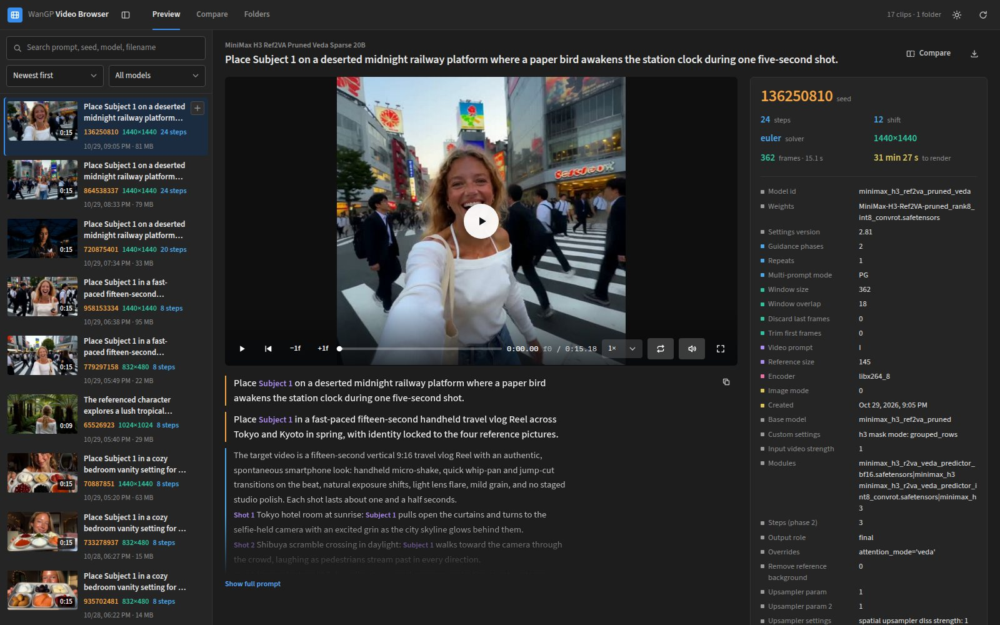
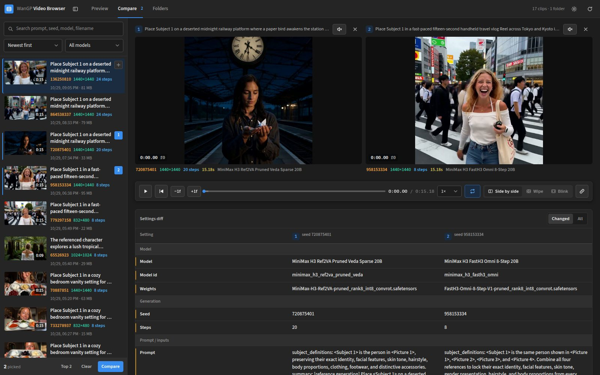
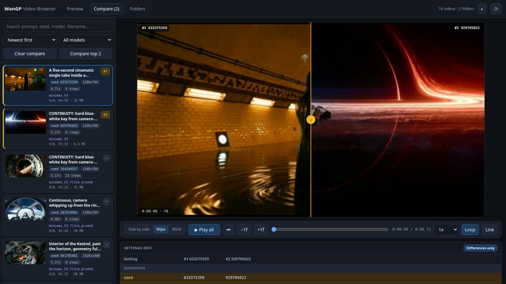
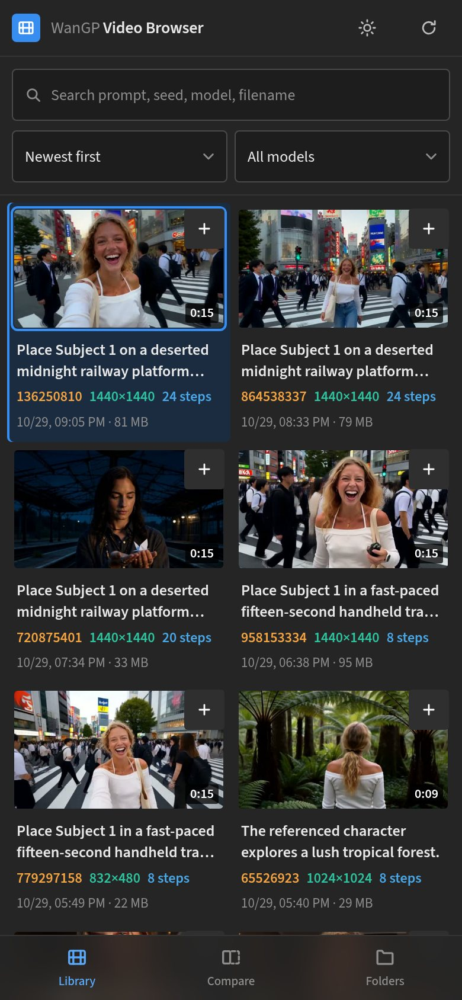
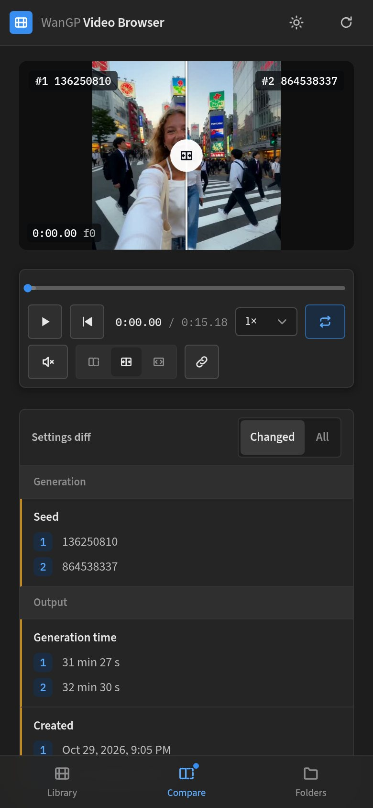
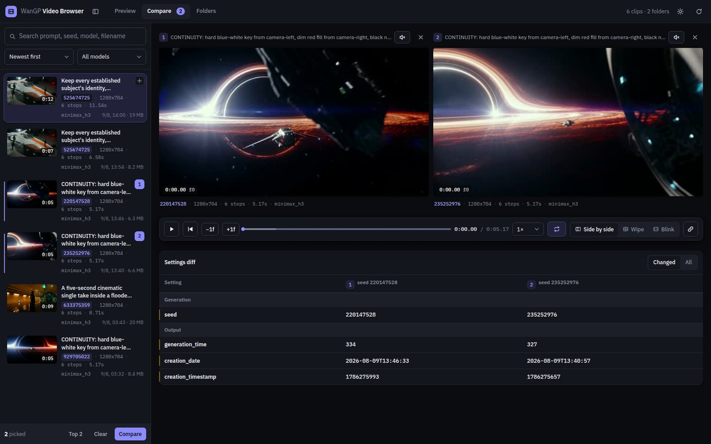

<div align="center">


# WanGP Video Browser

**Your WanGP outputs folder is a heap of 30 MB clips with 200-character filenames.**
**This turns it into a browsable library — and tells you exactly what changed between any two runs.**

A 1-click [Pinokio](https://pinokio.co) launcher for [Wan2GP / WanGP](https://github.com/deepbeepmeep/Wan2GP).
No dependencies, no config, no database — it finds your outputs by itself.

</div>



---

## The problem it solves

When you're dialling in a shot you end up with a dozen near-identical clips. Was the good one
15 steps or 8? Did the flow shift matter, or was it just a luckier seed?

The answer is already inside every file: **WanGP writes the full generation settings as JSON into
the MP4 itself** (the `©cmt` atom). Nothing reads it back — so the knowledge is stranded in files
you can't tell apart.

This app reads it back, and builds everything else on top.

---

## What you can do with it

### 🔎 Find the run you're thinking of

Every clip is indexed by its embedded settings — search by prompt text, seed, model or filename,
sort by date, size, duration or **how long it took to generate**. Each card shows the things that
actually differ between runs, so you can scan rather than read.

Pick one and the whole recipe is laid out underneath it: prompt, seed, sampler, steps, flow shift,
LoRAs, sliding-window settings, generation time, plus real stream info (codec, fps, bitrate).

### 🆚 See exactly what changed between two runs



Put up to four clips side by side on one shared transport — play them all together, scrub them
together, step a frame at a time, solo the audio of any one.

Underneath, the **settings diff** does the part you'd otherwise do by squinting: it lays all
~49 settings side by side and shows you only the ones that differ. In the shot above, two runs of
an identical prompt come down to four rows — *seed* and three timestamps. Everything else matched.

When the prompt itself changed, it goes further and diffs it **word by word**, striking through
what you removed and marking what you added, in place inside the sentence. Finding a three-word
change in a 400-word prompt stops being a reading exercise.

### 🎚️ Catch differences too subtle for side-by-side



Two clips a few pixels apart look the same when they're side by side. So there are two more modes
that put them in the **same screen position**:

- **Wipe** — stack them and drag the divider across.
- **Blink** — swap between them in place, by hand (`B`) or on an auto-flicker timer. Flicker two
  near-identical generations and whatever moved jumps straight out at you. The highlighted tag
  always tells you which one you're looking at.

### 📱 Works properly on your phone

 

Not a shrunk desktop layout — a different one. The library becomes a two-up contact sheet,
navigation moves to a bottom bar within thumb reach, preview arrives as a sheet, and comparison
defaults to **wipe**, because two 195-pixel-wide frames side by side tell you nothing while a
wipe uses the whole screen. The settings diff turns into stacked cards instead of an unreadable
three-column table.

Reach it from your phone over your LAN through Pinokio's remote access.

### 🌗 Fits wherever you run it



Follows your system or Pinokio colour scheme, with a manual override that sticks. The video
stages stay black in both themes, so nothing skews how you judge the footage.

---

## Install

**In Pinokio:** *Discover → Download from URL* →

```
https://github.com/Noeljarillo/wangp-video-browser
```

Then **Install** → **Start** → **Open Web UI**. Install takes seconds — there are no
Python dependencies to download.

It auto-discovers every `<PINOKIO_HOME>/api/*/app/outputs` folder, so an existing Wan2GP
install just shows up. Anything elsewhere can be added from the **Folders** tab and is remembered.

<details>
<summary><b>Running it outside Pinokio</b></summary>

```bash
cd app
python server.py --port 7899                     # auto-discovers outputs folders
python server.py --port 7899 --root /path/to/outputs --root /another/outputs
WANGP_OUTPUTS=/path/to/outputs python server.py  # or point it with an env var
```

Python 3.8+, standard library only. Binds to `127.0.0.1`. Set `WANGP_BROWSER_VERBOSE=1` for
request logging.
</details>

---

## How to use it

1. Pick a clip in the left list to inspect it in **Preview**.
2. Click **+** on a card (or double-click it) to add it to **Compare** — up to four.
3. With exactly two picked, switch to **Wipe** or **Blink**.
4. Read the **Settings diff** underneath to see what changed.
5. Hit **Link** to copy a URL that reopens that exact comparison, in that exact mode.

**Little things that add up:** sweep your mouse across any thumbnail to scrub that clip without
opening it · drag the divider between the library and the content to resize it, or collapse it
entirely for full-width comparison — both are remembered · every video uses a purpose-built
transport with a frame counter rather than the browser's default controls.

**Keyboard** (Compare tab): `Space` play/pause all · `←` `→` step one frame (`Shift` for 10) ·
`Home` back to start · `B` swap the blink clips. The wipe divider and the scrubber are both
focusable and driven with the arrow keys.

**Comparing something from outside your outputs folder?** Drag any video onto the window. Its
embedded WanGP metadata gets parsed in the browser and it joins the compare tray like any other.

---

## Requirements

- **Pinokio** (or any Python 3.8+).
- **Nothing else.** Metadata is parsed with a pure-Python MP4 box reader, so `ffprobe` isn't needed.
  The interface ships its own fonts, so it looks identical offline and on every machine.
- `ffmpeg`/`ffprobe` are used **if present** for thumbnails and exact stream info, and the app
  degrades gracefully without them.

Videos need to have been written by WanGP with metadata saving on (`metadata_type: "metadata"`,
its default). Older or re-encoded files still appear — just with empty settings.

---

## API

The server exposes a small JSON API on the same port as the UI. It listens on `7899` by
default — a fixed port, so it never collides with Wan2GP's launcher-assigned one. If 7899 is
taken it moves to the next free port and prints the address in the Terminal tab. Set
`WANGP_BROWSER_PORT` to pick a different one.

| Method | Endpoint | Purpose |
| --- | --- | --- |
| `GET` | `/api/videos` | Full index: every video with its embedded metadata and probe info |
| `GET` | `/api/rescan` | Re-scan all folders and return the refreshed index |
| `GET` | `/media/<id>` | Stream the video file (supports HTTP `Range`) |
| `GET` | `/thumb/<id>` | JPEG thumbnail (404 if ffmpeg is unavailable) |
| `POST` | `/api/roots/add` | Body `{"path": "..."}` — index an extra folder, remembered across restarts |
| `POST` | `/api/roots/remove` | Body `{"path": "..."}` — stop indexing a folder |

Each entry in `videos` looks like:

```json
{
  "id": "21f731e98b9c1a2c",
  "name": "2026-08-09-02h28m28s_seed164194557_....mp4",
  "path": "/home/you/pinokio/api/wan.git/app/outputs/....mp4",
  "root": "/home/you/pinokio/api/wan.git/app/outputs",
  "rel": "....mp4",
  "size": 36538207,
  "mtime": 1786235353.0,
  "filename_info": { "date": "2026-08-09", "time": "02:28:28", "seed": 164194557, "tags": "duration=5s" },
  "probe": { "duration": 5.1667, "width": 2560, "height": 1408, "fps": 24.0,
             "codec": "h264", "bitrate": 56575284, "frames": 124, "has_audio": true },
  "meta": { "seed": 164194557, "prompt": "...", "model_type": "minimax_h3_fl2va_pruned",
            "num_inference_steps": 15, "flow_shift": 12, "resolution": "1280x704", "...": "..." }
}
```

`meta` is WanGP's own settings blob, passed through untouched — it is `{}` for videos
that carry no embedded metadata.

### curl

```bash
# List every indexed video with its seed and model
curl -s http://127.0.0.1:7899/api/videos |
  python3 -c "import json,sys;[print(v['meta'].get('seed'), v['meta'].get('model_type'), v['name']) for v in json.load(sys.stdin)['videos']]"

# Re-scan after a new generation finishes
curl -s http://127.0.0.1:7899/api/rescan > /dev/null

# Index another outputs folder
curl -s -X POST -H "Content-Type: application/json" \
  -d '{"path":"/mnt/big-disk/wan-outputs"}' \
  http://127.0.0.1:7899/api/roots/add

# Download one video by id
curl -s -o clip.mp4 http://127.0.0.1:7899/media/21f731e98b9c1a2c
```

### Python

```python
import json, urllib.request

BASE = "http://127.0.0.1:7899"

def get(path):
    with urllib.request.urlopen(BASE + path) as response:
        return json.load(response)

def post(path, payload):
    request = urllib.request.Request(
        BASE + path,
        data=json.dumps(payload).encode(),
        headers={"Content-Type": "application/json"},
    )
    with urllib.request.urlopen(request) as response:
        return json.load(response)

index = get("/api/videos")

# Which settings differ between the two most recent generations?
a, b = index["videos"][0]["meta"], index["videos"][1]["meta"]
for key in sorted(set(a) | set(b)):
    if a.get(key) != b.get(key):
        print(f"{key}: {a.get(key)!r} -> {b.get(key)!r}")

# Every run that used a given model, slowest first
runs = [v for v in index["videos"] if v["meta"].get("model_type") == "minimax_h3_fl2va_pruned"]
for video in sorted(runs, key=lambda v: v["meta"].get("generation_time", 0), reverse=True):
    print(video["meta"].get("generation_time"), video["meta"].get("num_inference_steps"), video["name"])

post("/api/roots/add", {"path": "/mnt/big-disk/wan-outputs"})
```

The same parsing is available without the server running:

```python
import sys
sys.path.insert(0, "app")
from server import read_video_metadata

print(read_video_metadata("/path/to/output.mp4")["seed"])
```

### JavaScript

```javascript
const BASE = "http://127.0.0.1:7899";

const index = await fetch(`${BASE}/api/videos`).then((r) => r.json());

// Group generations by seed to spot repeated experiments
const bySeed = new Map();
for (const video of index.videos) {
  const seed = video.meta?.seed ?? "unknown";
  bySeed.set(seed, [...(bySeed.get(seed) ?? []), video.name]);
}
console.log(bySeed);

// Build a compare permalink for the two newest results
const ids = index.videos.slice(0, 2).map((v) => v.id).join(",");
console.log(`${BASE}/?compare=${ids}`);

// Add another outputs folder
await fetch(`${BASE}/api/roots/add`, {
  method: "POST",
  headers: { "Content-Type": "application/json" },
  body: JSON.stringify({ path: "/mnt/big-disk/wan-outputs" }),
});
```

## Notes

- The index is cached in `app/.cache/` keyed by path + size + mtime, so rescans are cheap.
  **Reset** clears the venv and that cache; it never touches your videos.
- The server only ever **reads** your video files — nothing is modified, moved or deleted.
- Thumbnails double as poster frames, so clips show a real still instead of a black box
  before you press play.
- Colours are checked against WCAG AA in both themes, every control is reachable from the
  keyboard, and all motion is disabled under `prefers-reduced-motion`.

## Credits

Typeface is [IBM Plex](https://github.com/IBM/plex) (Sans + Mono), bundled under the
[SIL Open Font License 1.1](app/web/fonts/LICENSE.txt) so the app renders identically offline
and on every device. Icons are drawn in the page — no icon font, no CDN, no external requests
of any kind.
